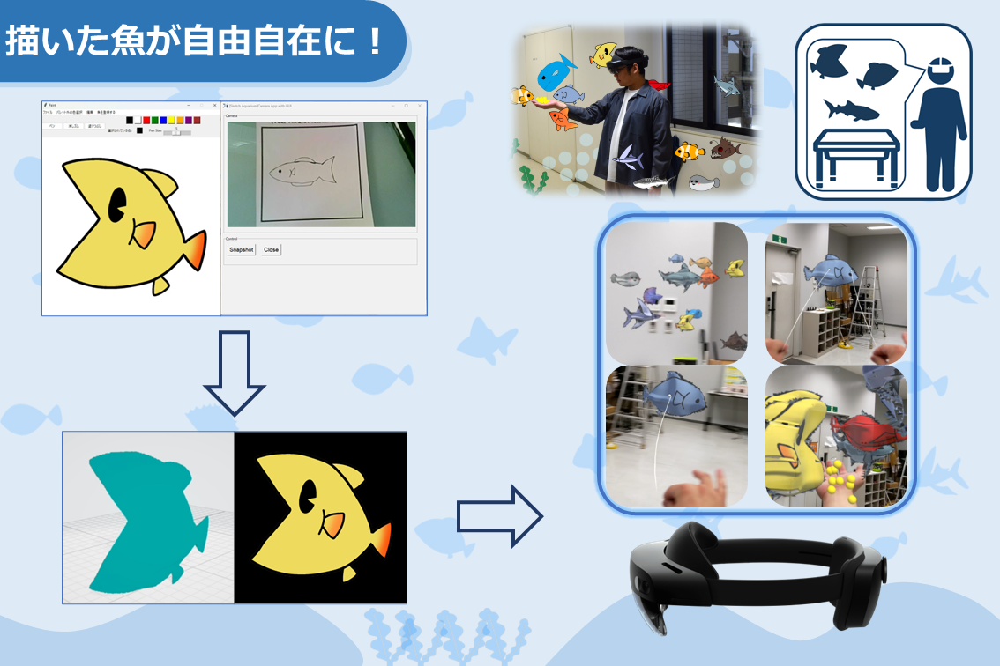

この記事は、ニュース記事内に **画像** と **YouTube動画** を埋め込むサンプルです。
Jekyll(kramdown)ではMarkdownとHTMLタグを混在させて書くことができます。

## 画像の埋め込み方

通常のMarkdown記法で画像を挿入できます。

```markdown

```


<div class="watermark-container">

</div>


<div class="image-row">
  <!-- 左側の画像とキャプション -->
  <figure class="image-wrapper">
    <div class="watermark-container">
      
    </div>
    <figcaption class="image-caption">デモシステムの全体構成</figcaption>
  </figure>

  <!-- 右側の画像とキャプション -->
  <figure class="image-wrapper">
    <div class="watermark-container">
      
    </div>
    <figcaption class="image-caption">会場で質問に答える様子</figcaption>
  </figure>
</div>


## YouTube動画の埋め込み方

HTMLの `iframe` タグをそのまま記事内に貼り付けるだけで埋め込めます。
`assets/css/style.css` 側で `.post-body iframe` にレスポンシブ対応のスタイルを
あらかじめ適用しているため、スマホでも自動的に幅いっぱいで表示されます。

```html
<iframe src="https://www.youtube.com/embed/dQw4w9WgXcQ"
        title="YouTube video" allowfullscreen></iframe>
```

<iframe src="https://www.youtube.com/embed/dQw4w9WgXcQ"
        title="YouTube video" allowfullscreen></iframe>

以上のように、Markdownの手軽さとHTMLの自由度を組み合わせて記事を書くことができます。

## リンクカード

