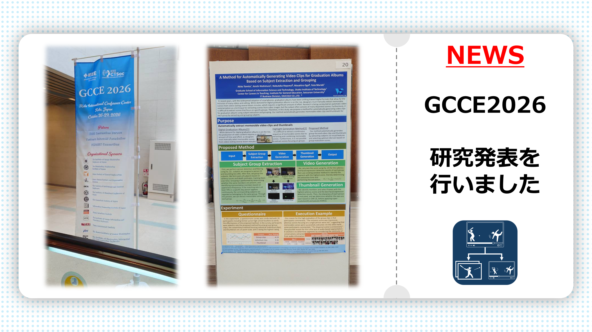
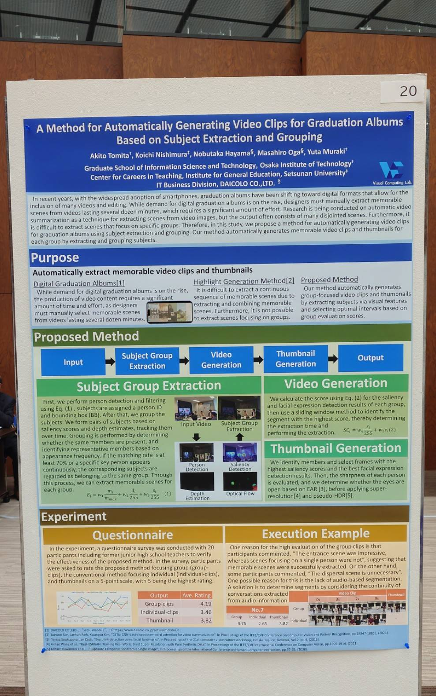
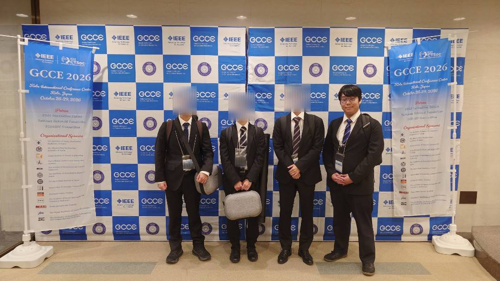

  

    
  

2026年10月に兵庫県で開催された国際会議、IEEE GCCE 2026にて研究発表を行いました。

## 学会情報
**2026 IEEE 15th Global Conference on Consumer Electronics (GCCE 2026)** 
（発表：2026年10月）

    <a href="https://www.ieee-gcce.org/2026/index.html" target="_blank" rel="noopener noreferrer" class="btn">公式サイトを見る</a>

## 発表題目
> **A Method for Automatically Generating Video Clips for Graduation Albums Based on Subject Extraction and Grouping**

本研究は、被写体の抽出とグルーピングに基づき、卒業アルバム用の動画クリップを自動生成する手法についての提案です。

## メディア掲載(2026/11/06 追記)
大阪工業大学のHPに「ニュース」として掲載いただきただいております！



## 写真

  <figure class="image-wrapper">
    

      
    

    <figcaption class="image-caption">ポスター</figcaption>
  </figure>

  <figure class="image-wrapper">
    

      
    

    <figcaption class="image-caption">GCCE発表者</figcaption>
  </figure>

