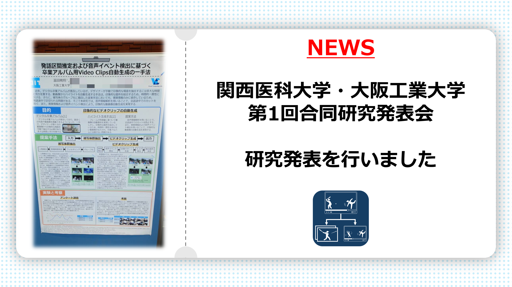
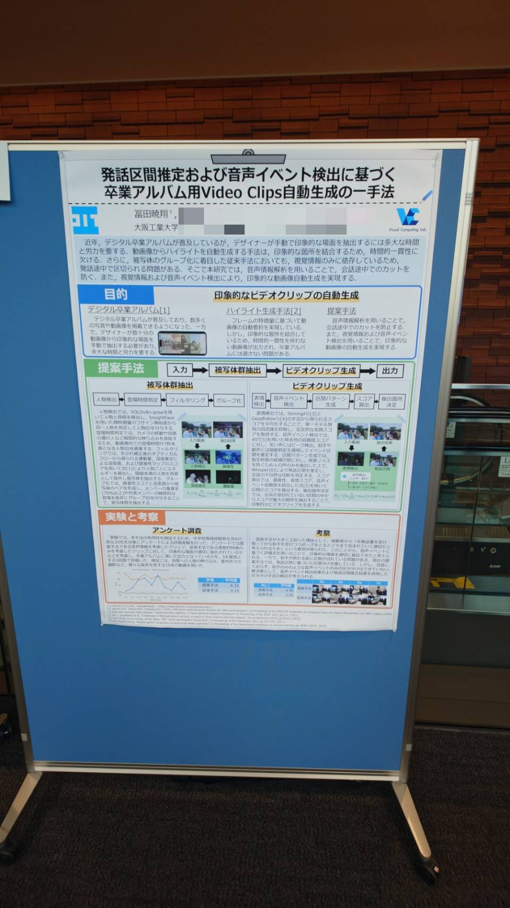

  

    
  

2026年10月に大阪府で開催された研究発表会、関西医科大学・大阪工業大学合同研究発表会にてポスター発表を行いました。

## 学会情報
**関西医科大学・大阪工業大学　第1回合同研究発表会—医・工・情報の融合による新たな研究展開—** 
（発表：2026年10月）

    <a href="https://www.oit.ac.jp/news/topics/l6l89f0000001zdc.html" target="_blank" rel="noopener noreferrer" class="btn">公式サイトを見る</a>

## 発表題目
> **発話区間推定および音声イベント検出に基づく卒業アルバム用Video Clips自動生成の一手法**

本研究は、発話区間推定および音声イベント検出に基づき、卒業アルバム用の動画クリップを自動生成する手法についての提案です。

## 写真

  <figure class="image-wrapper">
    

      
    

    <figcaption class="image-caption">ポスター</figcaption>
  </figure>

